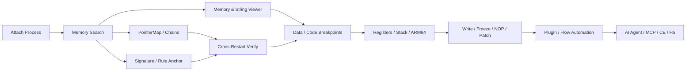

<p align="center">
  
</p>

<h1 align="center">MT MemoryToolkit</h1>

<p align="center">
  <strong>iOS ARM64 Dynamic Memory Analysis, Hardware Breakpoint Debugging &amp; Automation Workbench</strong>
</p>

<p align="center">
  From memory search, drift-resistant localization, hardware breakpoints, and ARM64 inspection<br>
  to live patch validation, standalone plugin synthesis, and AI / MCP / Cheat Engine / H5 collaboration—<br>
  turning one-off runtime investigation into a repeatable, verifiable engineering workflow.
</p>

<p align="center">
  <a href="https://github.com/susu123oss/MemoryToolkit-Release/releases/latest"></a>
  
  
  
  
</p>

<p align="center">
  <strong>English</strong> · <a href="./README_CN.md">简体中文</a>
</p>

<p align="center">
  <a href="#download--installation">Download</a> ·
  <a href="#what-is-memorytoolkit">Overview</a> ·
  <a href="#core-capabilities">Capabilities</a> ·
  <a href="#typical-analysis-workflow">Workflow</a> ·
  <a href="#ai--mcp--cheat-engine--h5">Collaboration</a> ·
  <a href="#on-device-floating-hud">Mobile HUD</a> ·
  <a href="#compatibility--runtime-boundaries">Compatibility</a> ·
  <a href="#getting-started-path">Getting Started</a>
</p>

> [!NOTE]
> **MT MemoryToolkit** is a general-purpose runtime debugging and dynamic analysis workbench designed strictly for security research, reverse engineering education, and authorized technical testing. It does not target any specific application.

---

## Download &amp; Installation

Download the package matching your iOS environment from [**GitHub Releases**](https://github.com/susu123oss/MemoryToolkit-Release/releases) (where full version history and release notes are also maintained):

<p align="center">
  <a href="https://github.com/susu123oss/MemoryToolkit-Release/releases/latest"><strong>⬇ Download Latest Release</strong></a>
</p>

| Environment Type | Package &amp; Scheme | Typical iOS Range | Common Tools / Examples | Characteristics &amp; Selection Notes |
| :--- | :--- | :--- | :--- | :--- |
| **TrollStore**<br>*(No Jailbreak)* | `MT-MemoryToolkit-*.tipa`<br>`arm64` Standalone App | `iOS 14.0 – 16.6.1`<br>`iOS 17.0` | • **TrollStore** / **TrollStore Lite** | Installs directly via CoreTrust persistence without a full jailbreak. Recommended for stock TrollStore devices and **Bootstrap** semi-jailbreak setups. |
| **Rootless Jailbreak** | `MT-MemoryToolkit-*-rootless.deb`<br>`iphoneos-arm64` (`/var/jb`) | `iOS 15.0+` | • **Dopamine** *(Standard)*<br>• **NathanLR**<br>• **palera1n (Rootless)**<br>• **XinaA15** / **Fugu15** | Modern mainstream jailbreak model. Leaves the system root volume untouched and stores jailbreak files under `/var/jb` for better system stability and safety. |
| **RootHide Jailbreak** | `MT-MemoryToolkit-*-roothide.deb`<br>`iphoneos-arm64e` (`.jbroot`) | `iOS 15.0+` | • **Dopamine (RootHide)**<br>• **Relaxin** / **Relaxin Lite** | Stealth-oriented jailbreak with randomized `.jbroot` paths designed to hide jailbreak artifacts and reduce app detection risk. |
| **Rootful Jailbreak** | `MT-MemoryToolkit-*-rootful.deb`<br>Legacy Rootful (`/Applications`) | Primarily `iOS 14` &amp; earlier<br>*(plus `palera1n` Rootful)* | • **unc0ver** / **Taurine**<br>• **Odyssey** / **Chimera**<br>• **checkra1n** / **palera1n (Rootful)** | Classic rootful jailbreak with direct read/write access to the system root filesystem (`/`), installed via Sileo, Cydia, or Zebra. |

> [!IMPORTANT]
> - **Quick Selection Rule**: Stock TrollStore or Bootstrap-only device → choose **`.tipa`**; standard Rootless jailbreaks (`Dopamine` / `NathanLR` / `XinaA15`) → choose **`-rootless.deb`**; `RootHide` stealth jailbreaks (`Dopamine RootHide` / `Relaxin`, where package manager shows `iphoneos-arm64e`) → choose **`-roothide.deb`**; classic iOS 14 jailbreaks (`unc0ver` / `Taurine` / `checkra1n`) → choose **`-rootful.deb`**. Do not cross-install mismatched formats.
> - **About Architecture Tags**: Labels such as `iphoneos-arm`, `iphoneos-arm64`, and `iphoneos-arm64e` in package managers identify the **jailbreak packaging scheme (runtime environment)** rather than your iPhone's physical CPU model.

---

## What Is MemoryToolkit

Most mobile memory utilities stop at *"search a number → overwrite a number"*. **MemoryToolkit** is built around the full closed loop of runtime analysis:

| Stage | Objective | How MemoryToolkit Solves It |
| :--- | :--- | :--- |
| **1. Discover Data** | Locate candidate addresses | Exact, Refine, Range, Fuzzy, Delta Fuzzy, Group/Union, Nearby, Multi-Encoding String, and XOR scans |
| **2. Anchor Reliably** | Survive ASLR &amp; restarts | Streaming `PointerMap`, multi-level pointer chains, cross-restart verification, Auto Signatures, and Rule Anchors |
| **3. Explain Behavior** | Find who reads/writes &amp; why | `DBGWVR` data watchpoints, `DBGBVR` code breakpoints, live register states, call stacks, and ARM64 disassembly |
| **4. Validate Changes** | Test hypotheses safely | Direct writes, high-frequency freezing, live register edits, `NOP`, and ARM64 patches with original-byte restoration |
| **5. Solidify Results** | Make findings reusable | Package pointers, signatures, rule anchors, patches, and structured `Flow` scripts into standalone `.dylib` plugins |
| **6. Collaborate** | Connect external workflows | Expose the same live runtime engine through built-in AI Agent, MCP Server, Cheat Engine Server, and H5 Bridge |

Viewed one feature at a time, MT looks like a memory scanner; viewed across the entire loop, it operates as a self-contained **iOS ARM64 Dynamic Memory Analysis &amp; Automation Workbench** running natively on iPhone.

---

## Core Capabilities

### 1. Memory Search &amp; Large-Scale Result Management

| Dimension | Supported Scope |
| :--- | :--- |
| **Data Types** | `I8 / I16 / I32 / I64` · `U8 / U16 / U32 / U64` · `F32 / F64` · `UTF-8 / UTF-16LE / UTF-16BE` Strings · Raw `Hex` Bytes |
| **Scan Modes** | Exact · Refine · Range · Fuzzy (`Increased`, `Decreased`, `Changed`, `Unchanged`, `Equal`) · Delta Fuzzy · Group &amp; Mixed-Type Union · Nearby · String · XOR · Multi-Step Undo |
| **Result Actions** | Batch Edit · Incremental Write · Freeze / Unfreeze · Address Offset Calculation · Favorites · Per-Type Filtering · Batch Delete |
| **Large Result Sets** | Automatic disk-backed `mmap` result store (including per-address fuzzy baselines) to keep RAM usage bounded under multi-million hit workloads |

### 2. Memory Viewer &amp; Multi-Encoding String Editor

Inspect surrounding memory structures and transition seamlessly from raw data to executable code:

- **Flexible Navigation**: Jump by absolute address or `Module + Offset`, with full jump history and one-tap return.
- **Live Context Inspection**: Synchronized typed value / Hex view, in-place refresh, and streaming `Str` string page browsing.
- **Standalone String Editor**: Dedicated multi-encoding string inspector and editor (`UTF-8`, `UTF-16LE`, `UTF-16BE`) with safe boundary write-back.
- **Cross-Tool Handoff**: Jump directly from pointers, watchpoint hits, or stack frames into the Memory Viewer or ARM64 Disassembler.

### 3. PointerMap &amp; Multi-Level Pointer Chains

Convert volatile heap addresses into stable static-module chains that survive restarts:

- **Dual Engines**: High-speed streaming **PointerMap** snapshot + reverse BFS alongside classic Legacy pointer scanning.
- **ARM64 &amp; Graph Precision**: PAC pointer stripping, positive/negative offsets, cycle detection, validity filtering, and disk-bucketed large result storage.
- **Verification &amp; Self-Healing**: Save pointer files, run batch verification or multi-file cross-verification across restarts, and export directly to plugins. When a chain drifts slightly, MT can attempt nearby offset recovery, block scanning, and search-engine rescue rather than discarding the chain outright.

### 4. Auto Signatures &amp; Rule Anchors

Beyond pointer chains, MT provides two complementary ways to anchor dynamic targets:

| Approach | Capabilities &amp; Best Fit |
| :--- | :--- |
| **Auto Signature** | Upward, downward, or bidirectional context sampling · Dual-snapshot comparison · Lossless raw-byte/width feature extraction · Quality scoring · Snapshot persistence · Live match testing · Plugin export |
| **Rule Anchor** | Anchor value &amp; data type · Min/Max address bounds · Multiple relative-offset validation conditions · Multiple relative-offset writes for structured objects |

### 5. Data Hardware Watchpoints (`DBGWVR`)

Once you know *which* value changes, trace *which instruction* reads or writes it:

- **Watch Modes &amp; Widths**: `Read`, `Write`, and `Read / Write` across `1 / 2 / 4 / 8`-byte widths (up to 4 concurrent hardware slots per ARM64 debug architecture).
- **Rich Hit Telemetry**: Hit counter, old value vs. new value diff, actual access type resolution, source `PC` filtering, hit-site disassembly, unwound call stack, and full register snapshot.

### 6. Code Hardware Breakpoints (`DBGBVR`) &amp; Live Registers

After tracing a watchpoint to a specific ARM64 instruction, observe or alter live execution context with `DBGBVR` hardware code breakpoints (up to 6 concurrent slots):

- **Execution Control**: Enable/disable while preserving entries, track hit counts and module offsets, filter by caller return address (`LR`), inspect non-pausing traces, or pause the hitting thread to modify registers live before `Resume`.
- **Inspectable Thread State**:
  - General-purpose registers `X0–X28` with **Current vs. Previous** hit comparison
  - Frame &amp; link registers `FP (X29)`, `LR (X30)`, `SP`, `PC`, and `PSTATE / NZCV` condition flags
  - Live stack data preview, `Module + Offset`, IDA-style rebased address, and full `FP`-chain Call Stack

### 7. ARM64 Disassembler, Assembler &amp; Live Patching

- **Disassembly**: Single-instruction, continuous stream, and function-level disassembly with `LC_FUNCTION_STARTS` function boundary detection, conditional/unconditional branch target resolution, and bilingual (`EN / 中文`) instruction semantics.
- **Assembly &amp; Branch Expansion**: Bidirectional `ARM64 ⇄ Machine Code` encoding, PC-relative fixups, and automatic far conditional branch trampoline expansion.
- **Reversible Patching**: One-tap `NOP`, custom instruction `Patch`, and `Restore`—retaining both original and patched bytes for conflict checks and clean rollback.

### 8. Standalone Plugin Composer &amp; Flow Automation

MT plugins go far beyond saving static addresses—synthesize standalone `.dylib` plugins directly on device with a frosted floating ball and unified multi-tab UI:

| Plugin Item Type | Role |
| :--- | :--- |
| **Pointer** | Multi-level module-relative pointer chain modification &amp; high-frequency freezing |
| **Patch** | ARM64 instruction or raw machine-code patch with toggleable byte restoration |
| **Signature** | Runtime byte-signature localization &amp; offset modification |
| **Rule Anchor** | Multi-condition memory structure matching &amp; multi-offset writes |
| **Flow** | Structured automation graph (*Search → Refine/Filter → Conditional Branch → Loop/Offset Write*) with automatic reverse-order byte rollback on stop |

The built-in **Plugin Maker** supports live in-app **Test** and **Restore** before exporting the final `.dylib`.

---

## Typical Analysis Workflow



In practice, a complete investigation typically progresses step by step:

```text
Value or Behavior Changes
  ↓  Memory Search to isolate candidate addresses
  ↓  Stable Localization (Pointer Chain / Auto Signature / Rule Anchor)
  ↓  Data Hardware Watchpoint (DBGWVR) to catch the exact accessing instruction
  ↓  Code Hardware Breakpoint (DBGBVR) + Registers + Call Stack
  ↓  ARM64 Disassembly & Control-Flow Inspection
  ↓  Live Write / Freeze / Register Edit / NOP / Patch Validation
  ↓  Solidify into a Standalone Plugin or Automated Flow
```

This is what separates **MemoryToolkit** from a plain value scanner: **finding an address is the starting point of analysis—never the finish line.**

---

## AI / MCP / Cheat Engine / H5

### Built-in AI Agent
Instead of guessing from text prompts alone, the built-in AI Agent reads live runtime facts through a unified read-only/validation tool layer—inspecting process state, memory regions, search results, module symbols, non-pausing breakpoints, registers, call stacks, and ARM64 disassembly to formulate verifiable patch plans. Supports OpenAI- and Anthropic-compatible APIs with configurable Base URL, model, and Thinking budget.

### MCP Server
Built-in **Model Context Protocol** server supporting **Streamable HTTP / Session** (`/mcp`) alongside legacy **SSE** (`/sse`). Ideal over USB port forwarding or trusted Wi-Fi LAN so desktop AI coding/reversing clients can orchestrate live iPhone runtime inspection, patch validation, and plugin assembly.

### Cheat Engine Server
Built-in `ceserver` protocol service allowing desktop **Cheat Engine** (`CE 7.5+` supported, `CE 7.6` recommended) to connect over USB/`iproxy` or Wi-Fi for remote scanning, module inspection, and memory browsing.

### H5 Bridge
Floating WebView runtime compatible with common **H5GG-style** JavaScript APIs—covering process attachment, search/refine/nearby scans, result reading/writing/`EditAll`, module enumeration, raw byte writes, window geometry control, and orientation callbacks (implemented as a practical compatibility subset rather than a 1:1 clone).

> [!WARNING]
> **MCP Server** and **Cheat Engine Server** expose high-privilege debugging capabilities. Enable them only over USB port forwarding or trusted private networks—never expose them to untrusted public networks. AI and automated outputs should always be reviewed against live registers, memory, and disassembly.

---

## On-Device Floating HUD

Engineered specifically for single-device iOS debugging without constant app switching:

- **Geometry &amp; Orientation**: Supports `Portrait`, `LandscapeLeft`, and `LandscapeRight`, automatically following the foreground target app with independent saved coordinates per orientation and touch-clamp correction.
- **Lock-Screen Safe Lifecycle**: Cleanly destroys the floating render context upon screen lock and settles orientation invisibly upon unlock before revealing.
- **Themes &amp; Bilingual UI**: 6 curated accent palettes, `Light / Dark / System` appearance tracking, `SF Mono` tabular alignment, and instant `English / 简体中文` live switching.
- **Built-in Debug Input Method**: Self-contained Pinyin &amp; dual-page symbol keyboard with quick debug tokens (`0x`, `_`, `/`, `=`, `:`), cursor movement keys, Caps Lock, and H5 input bridging.

---

## Compatibility &amp; Runtime Boundaries

| Item | Current Scope &amp; Behavior |
| :--- | :--- |
| **System** | iOS 14.0+ |
| **Architecture** | `iphoneos-arm64` (TrollStore / Rootful / Rootless); `iphoneos-arm64e` packaging for RootHide |
| **Installation** | TrollStore (`.tipa`) or Jailbreak Package Manager (`.deb`) |
| **Floating HUD** | Portrait + left/right landscape, following the active foreground app |
| **Data Watchpoints** | Up to 4 concurrent `DBGWVR` slots (bounded by ARM64 hardware &amp; kernel permissions) |
| **Code Breakpoints** | Up to 6 concurrent `DBGBVR` slots (dependent on device &amp; target-process debug permissions) |
| **Environment Probing** | Distinguishes Launcher brand, Runtime Family, Root Mode, and **actual runtime breakpoint capability** (including Dopamine, NathanLR, Relaxin, RootHide, Bootstrap, and TrollStore) |
| **Cheat Engine** | Cheat Engine 7.5+ (7.6 recommended) |
| **AI Agent** | Requires user-configured OpenAI / Anthropic compatible endpoint, API key, and model |
| **MCP Server** | Streamable HTTP / Session + SSE high-privilege interface (USB forwarding or trusted LAN only) |
| **H5 Runtime** | Practical H5GG-compatible API subset |

> [!TIP]
> Hardware breakpoint behavior varies across kernels and jailbreak flavors. Rather than assuming capabilities from a jailbreak's name alone, MT builds an environment profile first and dynamically verifies real Mach exception port and `DBGWVR / DBGBVR` availability against the attached target process—cleanly rolling back hardware state if exception monitoring is unavailable.

---

## Getting Started Path

If you are new to **MT MemoryToolkit**, exploring its modules in this order keeps the learning curve smooth:

1. Start with **Memory Search + Memory Viewer** to locate values and inspect surrounding structures.
2. When addresses shift across restarts, move to **PointerMap / Pointer Chains / Auto Signatures**.
3. When you want to know *why* a value changes, set a **Data Hardware Watchpoint (`DBGWVR`)**.
4. Once you catch the instruction, step into **Code Breakpoints (`DBGBVR`) + Registers + Call Stack + ARM64 Disassembler**.
5. After verifying your modification logic, solidify it with **Patch / Standalone Plugin / Flow Automation**.
6. Finally, connect **AI Agent / MCP / Cheat Engine / H5** whenever external automation or desktop collaboration helps.

---

## Responsible Use &amp; Safety

- Use **only** on devices, binaries, and environments you own, develop, or hold explicit permission to test.
- Do not use for unauthorized access, data exfiltration, undermining online service fairness, or any unlawful purpose.
- Memory writes, task freezing, hardware breakpoints, register edits, and ARM64 patches can crash target processes or corrupt state—always keep a rollback plan.
- Always cross-check AI suggestions, MCP actions, and automated flows against real register, memory, and disassembly state.

---

<p align="center">
  <strong>MT MemoryToolkit</strong><br>
  From discovering an address to anchoring it across restarts; from explaining live execution to solidifying repeatable workflows.
</p>
