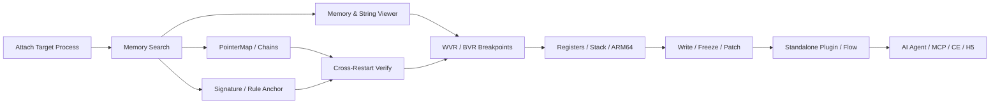

  

<h1 align="center">MT MemoryToolkit</h1>

  <strong>iOS ARM64 Dynamic Memory Analysis, Hardware Breakpoint Debugger &amp; Runtime Workbench</strong>

  Turn one-off runtime inspection into a repeatable workflow: from memory search, pointer/signature anchoring, and hardware breakpoints to ARM64 disassembly, live patching, standalone plugin synthesis, and AI / MCP / Cheat Engine collaboration.

  
  
  
  
  

  <strong>English</strong> · <a href="./README_CN.md">简体中文</a>

  <a href="#download--installation">Download</a> ·
  <a href="#whats-new-in-v193">What's New</a> ·
  <a href="#overview">Overview</a> ·
  <a href="#core-capabilities">Capabilities</a> ·
  <a href="#end-to-end-workflow">Workflow</a> ·
  <a href="#ai--mcp--cheat-engine--h5">AI &amp; Collaboration</a> ·
  <a href="#compatibility--boundaries">Compatibility</a>

> **Notice**: MT MemoryToolkit is a general-purpose runtime debugging and analysis workbench intended strictly for security research, reverse engineering education, and authorized technical testing. This repository hosts official release packages and user documentation.

---

## Download &amp; Installation

Grab the latest package matching your iOS environment from [**GitHub Releases**](https://github.com/susu123oss/MemoryToolkit-Release/releases/latest):

  <a href="https://github.com/susu123oss/MemoryToolkit-Release/releases/latest"><strong>⬇ Download Latest Release (v1.9.3)</strong></a>

| Environment | Package Filename | Notes |
| :--- | :--- | :--- |
| **TrollStore** | `MT-MemoryToolkit-vX.Y.Z.tipa` | Standalone app bundle for TrollStore (`arm64`) |
| **Rootless Jailbreak** | `MT-MemoryToolkit-vX.Y.Z-rootless.deb` | Installs to `/var/jb/Applications/MemoryToolkitApp.app` (`iphoneos-arm64`) |
| **RootHide Jailbreak** | `MT-MemoryToolkit-vX.Y.Z-roothide.deb` | Built for RootHide environments (`iphoneos-arm64e`) |
| **Rootful Jailbreak** | `MT-MemoryToolkit-vX.Y.Z-rootful.deb` | Installs to `/Applications/MemoryToolkitApp.app` (`iphoneos-arm64`) |

> Do not mix package formats across incompatible environments. Cross-process memory access, system-wide floating windows, and hardware debug register capabilities depend on your iOS version, kernel entitlements, and active TrollStore / jailbreak runtime.

---

## What's New in v1.9.3

- **Redesigned Built-in Input Method**: Refreshed keyboard visuals with dual-page symbol layouts (`123` / `#+=`), a top debug token bar (`0x`, `_`, `/`, `=`, `:`), left/right cursor keys, double-tap Caps Lock, and smooth hold-to-delete.
- **Disk-Backed Fuzzy Search &amp; Large Result Sets**: Automatically spills massive fuzzy search candidates and per-address baseline values to disk-mapped storage, reducing RAM pressure during multi-pass refinement and accelerating result table rendering.
- **Multi-Encoding String Editor &amp; Stream Viewer**: Added a dedicated String Editor supporting `UTF-8`, `UTF-16LE`, and `UTF-16BE` inspection and editing, plus a streaming `Str` page mode inside the Memory Viewer.
- **Refined Visuals &amp; 6 Color Themes**: Introduced 6 curated accent themes across Light, Dark, and System appearance modes, crisp pastel action controls, and tabular monospace typography (`SF Mono`) for addresses, disassembly, and live counters.
- **Upgraded Standalone MP Plugin UI**: Redesigned frosted floating ball and unified fixed-height multi-tab layout across Pointer, Patch, and Signature tabs so switching tabs never causes layout jumps.
- **Accurate Environment &amp; Icon Detection**: Resolved TrollStore icon priority, unjailbroken / residual semi-jailbreak lock-state display, and active jailbreak state recognition across iOS 14–17 environments.
- **Full Real-Time English / Chinese Localization**: Completed live language switching across the main app, floating HUD, ARM64 instruction translator, MCP logs, and exported MP plugins without mixed-language residue.

---

## Overview

Traditional mobile memory tools stop at *"search a value → overwrite a value"*. **MT MemoryToolkit** is built around a complete, verifiable runtime analysis loop directly on iPhone:

1. **Discover Data**: Narrow down candidate addresses with Exact, Range, Fuzzy, Delta Fuzzy, Group/Union, Nearby, String, or XOR scans.
2. **Anchor Reliably**: Survive ASLR and app restarts using streaming `PointerMap` chains, cross-session pointer verification, auto byte signatures, and multi-condition Rule Anchors.
3. **Explain Behavior**: Set ARM64 data watchpoints (`DBGWVR`) and code breakpoints (`DBGBVR`) to inspect who reads or writes an address, with live registers, call stacks, and disassembly.
4. **Validate Hypotheses**: Test findings safely through live value writes, address freezing, register edits, `NOP`, and ARM64 instruction patching with one-tap byte restoration.
5. **Package &amp; Reuse**: Synthesize verified pointers, patches, signatures, rule anchors, and structured `Flow` scripts into standalone `.dylib` plugins directly on device—no compiler required.
6. **Collaborate Externally**: Expose live device runtime facts to desktop workflows through the built-in AI Agent, MCP Server, Cheat Engine Server, and H5 JS Bridge.

---

## Core Capabilities

### 1. Memory Search &amp; Large Result Management
- **Data Types**: `I8 / I16 / I32 / I64`, `U8 / U16 / U32 / U64`, `F32 / F64`, `UTF-8 / UTF-16LE / UTF-16BE` strings, and raw Hex bytes.
- **Scan Modes**: Exact, Refine, Range, Fuzzy (`Increased`, `Decreased`, `Changed`, `Unchanged`, `Equal`), Delta Fuzzy, Group / Mixed-Type Union, Nearby, String, XOR, and multi-step Undo.
- **Result Operations**: Batch write, incremental write, freeze/unfreeze, address offset calculation, favorites, type filtering, and automatic disk-backed `mmap` storage for multi-million hit sets.

### 2. Memory Viewer &amp; String Editor
- Jump by absolute address or `Module + Offset`, with full navigation history.
- View synchronized Hex / typed values, refresh in place, or switch to streaming `Str` page browsing.
- Edit multi-encoding strings (`UTF-8 / UTF-16LE / UTF-16BE`) in the dedicated String Editor, or jump straight into the ARM64 Disassembler from any pointer, watchpoint, or stack frame.

### 3. PointerMap &amp; Multi-Level Pointer Chains
- High-speed streaming **PointerMap** snapshot &amp; reverse BFS scanner alongside legacy pointer search.
- PAC-aware pointer stripping, cycle detection, positive/negative offset ranges, and disk-bucketed large result storage.
- Cross-restart verification, multi-file cross-validation, automatic nearby offset recovery when chains drift, and direct export to standalone plugins.

### 4. Auto Signatures &amp; Rule Anchors
- **Auto Signature**: Upward, downward, or bidirectional byte context scanning, dual-snapshot diff scoring, lossless width-aware hex values, live match testing, and plugin export.
- **Rule Anchor**: Define an anchor value, type, address bounds, multi-offset validation predicates, and multi-offset target writes for structured memory structures.

### 5. ARM64 Hardware Breakpoints (Watchpoints &amp; Code Breakpoints)
- **Data Watchpoints (`DBGWVR`, up to 4 hardware slots)**: Monitor `Read`, `Write`, or `Read/Write` on `1 / 2 / 4 / 8`-byte widths; inspect hit counts, old vs. new values, source `PC` filters, disassembly context, call stacks, and register snapshots.
- **Code Breakpoints (`DBGBVR`, up to 6 hardware slots)**: Non-pausing trace mode or interactive thread-pausing mode; compare current vs. previous register states (`X0–X28`, `FP`, `LR`, `SP`, `PC`, `PSTATE/NZCV`, stack preview), filter by caller `LR`, modify registers live, and resume execution safely.

### 6. ARM64 Disassembler, Assembler &amp; Live Patching
- Single-instruction, continuous, and function-level ARM64 disassembly with `LC_FUNCTION_STARTS` boundary detection.
- Live `ARM64 ⇄ Machine Code` conversion, PC-relative branch resolution, automatic far conditional branch expansion, and bilingual instruction explanations.
- One-tap `NOP`, custom instruction `Patch`, and lossless original-byte `Restore`.

### 7. On-Device Plugin Composer &amp; Flow Automation
- Combine **Pointer**, **Patch**, **Signature**, **Rule Anchor**, and **Flow** items into a standalone `.dylib` plugin directly on your iPhone.
- **Flow Automation** turns manual multi-step routines (*search → filter → branch → offset write*) into structured, reversible execution graphs.

---

## End-to-End Workflow

---

## AI / MCP / Cheat Engine / H5

- **Built-in AI Agent**: Connects to OpenAI- or Anthropic-compatible endpoints (custom Base URL, model, and reasoning/thinking budget) and inspects real runtime facts—modules, memory regions, non-pausing breakpoints, registers, call stacks, and disassembly—to propose verifiable patches.
- **MCP Server**: Built-in Model Context Protocol server supporting **Streamable HTTP** (`/mcp`) and legacy **SSE** (`/sse`) so desktop AI coding assistants can query live iOS runtime state over USB port forwarding or trusted LAN.
- **Cheat Engine Server**: Built-in `ceserver` bridge compatible with PC Cheat Engine (CE 7.5+ supported, CE 7.6 recommended) over USB/`iproxy` or Wi-Fi.
- **H5 JS Bridge**: Built-in floating WebView supporting common H5GG-style scripting APIs for custom HTML5 tool panels.

> High-privilege remote interfaces (`MCP Server` and `Cheat Engine Server`) should only be enabled over USB port forwarding or trusted private networks.

---

## System-Wide Floating HUD &amp; Mobile UX

Designed specifically for uninterrupted on-device analysis without switching back and forth between apps:

- **Full Orientation Tracking**: Supports `Portrait`, `LandscapeLeft`, and `LandscapeRight` with independent saved positions per orientation.
- **Lock-Screen Safe Lifecycle**: Cleanly tears down and restores the floating HUD across screen lock/unlock transitions.
- **Appearance &amp; Localization**: 6 accent color palettes, `Light / Dark / System` theme tracking, and instant `English / 简体中文` UI switching.
- **Built-in Debug Keyboard**: Custom Pinyin &amp; dual-page symbol keyboard with quick hex/operator keys so floating inputs work reliably inside any host scene.

---

## MT Family Ecosystem

| Product | Positioning | Releases |
| :--- | :--- | :--- |
| **MT MemoryToolkit** | iOS ARM64 Dynamic Memory Analysis &amp; Debugging Workbench | **Current Repository** |
| **MT Agent** | On-Device AI Engineering Workspace, Compiler &amp; MCP Orchestrator | [susu123oss/MT-Agent](https://github.com/susu123oss/MT-Agent) |
| **MT AutoClicker** | System-Wide Visual Recognition (OCR / Template / Color) &amp; Touch Automation | [susu123oss/MT-Auto-clicker](https://github.com/susu123oss/MT-Auto-clicker) |

---

## Compatibility &amp; Boundaries

| Item | Specification |
| :--- | :--- |
| **OS Version** | iOS 14.0+ |
| **Architectures** | `arm64` (TrollStore / Rootful / Rootless) &amp; `arm64e` (RootHide) |
| **Installation** | TrollStore (`.tipa`) or Jailbreak Package Manager (`Sileo` / `Zebra` `.deb`) |
| **Data Watchpoints** | Up to 4 concurrent `DBGWVR` slots (subject to hardware &amp; kernel permissions) |
| **Code Breakpoints** | Up to 6 concurrent `DBGBVR` slots (probed dynamically per target process) |
| **Cheat Engine** | Cheat Engine 7.5+ (7.6 recommended) |
| **AI Providers** | User-configured OpenAI / Anthropic API endpoint &amp; key |

---

## Responsible Use

- Use **only** on devices, applications, and environments that you own, develop, or have explicit authorization to test.
- Never use this tool for unauthorized intrusion, data theft, unfair disruption of online services, or any unlawful activity.
- Direct memory writes, task freezing, hardware breakpoints, register edits, and instruction patches can crash target processes or corrupt state—always keep a rollback plan and verify AI/automated outputs against live memory and disassembly.

---

  <strong>MT MemoryToolkit</strong> 
  Discover · Anchor · Explain · Validate · Automate

