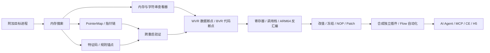

  

<h1 align="center">MT MemoryToolkit · MT 内存工具</h1>

  <strong>iOS ARM64 动态内存分析、硬件断点调试与运行时工作台</strong>

  把单次内存定位延伸为可复验的完整工作流：从内存搜索、指针与特征码锚定、硬件断点追踪，到 ARM64 反汇编、实时补丁验证、独立插件合成与 AI / MCP / Cheat Engine 协同分析。

  
  
  
  
  

  <a href="./README.md">English</a> · <strong>简体中文</strong>

  <a href="#下载与安装">下载安装</a> ·
  <a href="#v193-更新亮点">最新更新</a> ·
  <a href="#产品定位">产品定位</a> ·
  <a href="#核心能力">核心能力</a> ·
  <a href="#完整分析工作流">工作流</a> ·
  <a href="#ai--mcp--cheat-engine--h5">外部协作</a> ·
  <a href="#兼容性与边界">兼容性</a>

> **声明**：MT MemoryToolkit 是通用运行时调试与动态分析工具，仅用于安全研究、逆向工程学习与已获授权的技术测试。本仓库用于发布官方安装包与用户文档。

---

## 下载与安装

请前往 [**GitHub Releases**](https://github.com/susu123oss/MemoryToolkit-Release/releases/latest) 下载与你当前设备环境匹配的安装包：

  <a href="https://github.com/susu123oss/MemoryToolkit-Release/releases/latest"><strong>⬇ 前往下载最新版本（v1.9.3）</strong></a>

| 设备环境 | 安装包文件名 | 说明 |
| :--- | :--- | :--- |
| **TrollStore（巨魔）** | `MT-MemoryToolkit-vX.Y.Z.tipa` | 独立 App 安装包，适合 TrollStore 环境（`arm64`） |
| **Rootless 越狱** | `MT-MemoryToolkit-vX.Y.Z-rootless.deb` | 安装至 `/var/jb/Applications/MemoryToolkitApp.app`（`iphoneos-arm64`） |
| **RootHide 越狱** | `MT-MemoryToolkit-vX.Y.Z-roothide.deb` | 适配 RootHide 环境（`iphoneos-arm64e`） |
| **Rootful 越狱** | `MT-MemoryToolkit-vX.Y.Z-rootful.deb` | 安装至 `/Applications/MemoryToolkitApp.app`（`iphoneos-arm64`） |

> 不同包格式面向不同运行环境，请勿混装。跨进程内存读写、全局悬浮窗及硬件调试寄存器的可用范围取决于设备系统版本、内核权限以及当前 TrollStore 或越狱环境。

---

## v1.9.3 更新亮点

- **升级内置拼音与符号输入法**：重做键盘视觉层次，新增双页中英文符号切换、顶部常用调试字符（`0x` / `_` / `=` / `:` 等）快捷栏与左右光标移动键，支持英文双击锁定大写和长按连续退格。
- **优化模糊搜索与大结果集稳定性**：海量模糊搜索候选地址与上轮对比值自动转存磁盘映射存储，降低多次筛选时的内存占用与闪退风险，提速大结果集列表加载。
- **完善字符串搜索与内存查看器**：新增独立字符串编辑器，支持 `UTF-8` / `UTF-16LE` / `UTF-16BE` 多编码浏览与直接修改；内存查看器新增字符串流式翻页模式。
- **焕新界面视觉与 6 套主题色系**：新增晴空彩虹、薄荷青岚等 6 套主题配色（支持浅色 / 深色 / 跟随系统），统一清爽浅底按钮与 `SF Mono` 等宽地址数值排版，横竖屏旋转更顺滑。
- **升级 MP 独立插件体验**：换新磨砂悬浮球与面板布局，切换指针链、补丁和特征码分页时保持统一面板高度不再跳动，同时完善独立插件联网稳定性与状态提示。
- **修复设备环境与图标识别**：修正部分设备 TrollStore 图标优先级、未越狱或越狱残留状态下的图标显示，以及活跃越狱态判定逻辑。
- **完善全界面中英文实时切换**：补齐主界面、悬浮面板与汇编指令说明的英文翻译，同步支持导出 MP 插件中英文动态切换，消除双语混排残留。

---

## 产品定位

常规内存工具往往停留在「搜索数值 → 修改数值」。**MT MemoryToolkit** 围绕 iOS ARM64 真机运行时构建了一套完整的动态分析闭环：

1. **发现数据**：通过精确、范围、模糊、差值模糊、联合、临近、字符串或 XOR 搜索定位候选地址。
2. **稳定定位**：利用流式 `PointerMap`、多级指针跨重启验证、自动特征码与规则锚点抵抗 ASLR 地址漂移。
3. **解释变化**：借助数据硬件断点（`DBGWVR`）与代码硬件断点（`DBGBVR`），结合寄存器现场、调用栈和 ARM64 反汇编定位真实读写逻辑。
4. **修改验证**：通过数值写入、高频冻结、寄存器修改、`NOP` 与 ARM64 指令补丁验证分析结论，并随时一键还原原始字节。
5. **固化成果**：直接在手机端将指针链、特征码、规则锚点、机器码补丁与 `Flow` 自动化流程合成为独立 `.dylib` 插件，无需外部编译环境。
6. **扩展协作**：通过内置 AI Agent、MCP Server、Cheat Engine Server 与 H5 桥接接口连接桌面与自动化分析工具。

---

## 核心能力

### 1. 内存搜索与大结果集管理
- **数据类型**：`I8 / I16 / I32 / I64`、`U8 / U16 / U32 / U64`、`F32 / F64`、`UTF-8 / UTF-16LE / UTF-16BE` 字符串及原始 Hex 字节。
- **搜索模式**：精确搜索、二次改善、范围搜索、模糊搜索（变大 / 变小 / 变化 / 未变化 / 等于）、差值模糊搜索、同组与混合类型联合搜索、临近搜索、字符串搜索、XOR 搜索及多步搜索撤销。
- **结果处理**：支持批量修改、递增写入、冻结 / 解冻、偏移计算、收藏、按类型筛选，以及千万级结果集自动落盘 `mmap` 管理。

### 2. 内存查看器与多编码字符串编辑器
- 支持绝对地址或 `模块 + 偏移` 跳转，保留完整跳转历史。
- 支持数值与 Hex 同步浏览、原地刷新及 `Str` 字符串流式翻页模式。
- 内置独立字符串编辑器，支持 `UTF-8 / UTF-16LE / UTF-16BE` 上下文浏览与安全写回，并可从查看器、指针或栈帧一键跳入反汇编视图。

### 3. PointerMap 与多级指针链
- 提供高速流式 **PointerMap** 快照反向扫描与经典指针搜索双路径。
- 支持 PAC 指针剥离、循环引用检测、正负偏移配置与分桶磁盘持久化。
- 支持跨重启验证、多文件交叉验证、地址漂移附近自愈纠偏及一键加入插件。

### 4. 自动特征码与规则锚点
- **自动特征码**：支持向上 / 向下 / 双向字节窗口采样、双快照对比打分、无损位宽原始十六进制特征提取、实时匹配测试与插件导出。
- **规则锚点**：支持设置锚点搜索值、数据类型、地址区间、多组偏移校验条件与多组偏移目标写入。

### 5. ARM64 硬件断点（数据断点与代码断点）
- **数据硬件断点（`DBGWVR`，最多 4 槽）**：支持 `Read`、`Write`、`Read / Write` 与 `1 / 2 / 4 / 8` 字节监控，记录命中次数、新旧数值对比、来源 `PC` 过滤、命中汇编现场、调用栈与寄存器快照。
- **代码硬件断点（`DBGBVR`，最多 6 槽）**：支持非暂停统计跟踪与暂停线程交互调试两种模式；可对比前后寄存器变化（`X0–X28`、`FP`、`LR`、`SP`、`PC`、`PSTATE/NZCV` 与栈顶数据）、按返回地址 `LR` 过滤、实时修改寄存器并安全恢复执行。

### 6. ARM64 反汇编、汇编与补丁管理
- 支持单条、连续与函数级反汇编，自动解析 `LC_FUNCTION_STARTS` 函数边界与条件分支目标。
- 支持 `ARM64 ⇄ 机器码` 双向转换、PC 相对寻址修正、远距离条件跳转展开及中英双语指令语义说明。
- 支持一键 `NOP`、自定义指令补丁写入与原始字节无损恢复。

### 7. 手机端独立插件合成与 Flow 流程自动化
- 支持在设备端直接将 **Pointer**（指针链）、**Patch**（指令补丁）、**Signature**（特征码）、**Rule Anchor**（规则锚点）与 **Flow**（自动化流程）合成为独立运行的 `.dylib` 插件。
- **Flow 流程脚本**可将「搜索 → 条件筛选 → 判断分支 → 偏移写入」固化为结构化自动执行流程，并在关闭时自动逆序回滚原始内存字节。

---

## 完整分析工作流

---

## AI / MCP / Cheat Engine / H5

- **内置 AI Agent**：支持接入 OpenAI / Anthropic 兼容接口（自定义 Base URL、模型与思考深度），可直接读取目标进程模块、搜索结果、非暂停断点命中、寄存器、调用栈与反汇编现场，辅助生成可验证的补丁方案。
- **MCP Server**：内置 Model Context Protocol 服务端，同时支持 **Streamable HTTP**（`/mcp`）与 **SSE**（`/sse`），方便桌面端 AI 编程与逆向客户端通过 USB 端口转发或受信任局域网调用真机实时分析能力。
- **Cheat Engine Server**：内置 `ceserver` 协议桥接，支持电脑端 Cheat Engine（建议 CE 7.5+，推荐 CE 7.6）通过 USB / `iproxy` 或 Wi-Fi 远程连接扫描与调试。
- **H5 Bridge**：内置悬浮 WebView 运行时，兼容常用 H5GG 风格脚本接口，方便加载自定义前端面板。

> `MCP Server` 与 `Cheat Engine Server` 属于高权限调试接口，仅建议在 USB 转发或受信任的私有局域网中开启。

---

## 系统级悬浮交互与移动端体验

针对 iPhone 单机分析场景深度打磨，无需在工具与目标应用之间反复切屏：

- **全方向跟随**：支持竖屏与左右横屏，跟随前台应用自动旋转并独立记忆横竖屏悬浮位置。
- **锁屏安全生命周期**：锁屏自动销毁释放渲染上下文，解锁稳定后再显现，避免闪屏与系统强退。
- **多主题与双语切换**：内置 6 套强调色板，支持浅色 / 深色 / 跟随系统外观，支持中文与 English 实时无缝切换。
- **自研调试输入法**：内置拼音与双页符号键盘及十六进制快捷栏，解决系统级悬浮窗内的输入痛点。

---

## MT 家族生态

| 产品 | 定位 | 发布仓库 |
| :--- | :--- | :--- |
| **MT MemoryToolkit（MT 内存工具）** | iOS ARM64 动态内存分析与调试工作台 | **当前仓库** |
| **MT Agent（MT 智能体）** | 移动端 AI 工程工作站、编译构建与 MCP 协同中枢 | [susu123oss/MT-Agent](https://github.com/susu123oss/MT-Agent) |
| **MT AutoClicker（MT 连点器）** | 系统级图像识别（OCR / 找图 / 找色）与触控自动化工具 | [susu123oss/MT-Auto-clicker](https://github.com/susu123oss/MT-Auto-clicker) |

---

## 兼容性与边界

| 项目 | 支持范围 |
| :--- | :--- |
| **系统版本** | iOS 14.0+ |
| **处理器架构** | `arm64`（TrollStore / Rootful / Rootless）与 `arm64e`（RootHide） |
| **安装方式** | TrollStore（`.tipa`）或越狱包管理器（`Sileo` / `Zebra` `.deb`） |
| **数据硬件断点** | 最多同时管理 4 个 `DBGWVR` 槽位（受硬件寄存器数量与内核权限限制） |
| **代码硬件断点** | 最多同时管理 6 个 `DBGBVR` 槽位（启用时按目标进程实际权限动态探测确认） |
| **Cheat Engine** | 建议 CE 7.5+，推荐 CE 7.6 |
| **AI 接口** | 需自行配置可访问的 OpenAI / Anthropic 兼容接口与密钥 |

---

## 合规使用边界

- 仅在您本人拥有、开发或已获得明确书面测试授权的设备与目标程序上使用。
- 严禁用于未经授权的侵入、数据窃取、破坏线上服务公平性或任何违反所在地法律法规的行为。
- 内存写入、进程冻结、硬件断点、寄存器修改与指令补丁均可能导致目标进程异常退出或数据损坏，操作前请做好备份并对 AI 或自动化输出进行人工复核。

---

  <strong>MT MemoryToolkit</strong> 
  发现数据 · 稳定锚定 · 解释现场 · 验证固化

