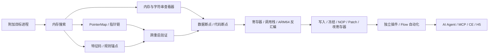

<p align="center">
  
</p>

<h1 align="center">MT MemoryToolkit · MT 内存工具</h1>

<p align="center">
  <strong>iOS ARM64 动态内存分析、硬件断点调试与自动化工作台</strong>
</p>

<p align="center">
  从内存搜索、稳定定位、硬件断点与 ARM64 现场分析，<br>
  到补丁验证、独立插件固化，以及 AI / MCP / Cheat Engine / H5 扩展协作——<br>
  把一次性的分析过程沉淀为可重复执行的完整工程工作流。
</p>

<p align="center">
  <a href="https://github.com/susu123oss/MemoryToolkit-Release/releases/latest"></a>
  
  
  
  
</p>

<p align="center">
  <a href="./README.md">English</a> · <strong>简体中文</strong>
</p>

<p align="center">
  <a href="#下载与安装">下载安装</a> ·
  <a href="#memorytoolkit-是什么">产品定位</a> ·
  <a href="#核心能力详解">核心能力</a> ·
  <a href="#典型分析工作流">典型工作流</a> ·
  <a href="#ai--mcp--cheat-engine--h5">扩展协作</a> ·
  <a href="#手机端系统级悬浮交互">手机端交互</a> ·
  <a href="#兼容性与运行边界">兼容性</a> ·
  <a href="#循序渐进使用建议">使用建议</a>
</p>

> [!NOTE]
> **MT MemoryToolkit** 是通用技术调试与动态分析工具，仅用于安全研究、逆向工程学习与已获授权的技术测试，不针对任何特定应用。

---

## 下载与安装

请从本仓库 [**GitHub Releases**](https://github.com/susu123oss/MemoryToolkit-Release/releases) 下载与你当前设备环境匹配的安装包（往期版本归档与详细更新日志亦在 Releases 页面查看）：

<p align="center">
  <a href="https://github.com/susu123oss/MemoryToolkit-Release/releases/latest"><strong>⬇ 前往下载最新版本</strong></a>
</p>

| 设备环境 | 安装包格式 | 安装路径与说明 |
| :--- | :--- | :--- |
| **TrollStore（巨魔）** | `MT-MemoryToolkit-*.tipa` | 独立 App 安装包，适合 TrollStore 环境（`arm64`） |
| **Rootless 越狱** | `MT-MemoryToolkit-*-rootless.deb` | 安装到 `/var/jb/Applications/MemoryToolkitApp.app`（`iphoneos-arm64`） |
| **RootHide 越狱** | `MT-MemoryToolkit-*-roothide.deb` | 适配 RootHide 运行环境（`iphoneos-arm64e`） |
| **Rootful 越狱** | `MT-MemoryToolkit-*-rootful.deb` | 安装到 `/Applications/MemoryToolkitApp.app`（`iphoneos-arm64`） |

> [!IMPORTANT]
> `TIPA` 与三种 `DEB` 面向不同运行环境，请勿混装。跨进程内存访问、系统级悬浮窗与硬件断点能力仍取决于设备权限、系统版本以及当前越狱或 TrollStore 环境。

---

## MemoryToolkit 是什么

很多内存工具的主要流程停留在「搜索数值 → 修改数值」。**MemoryToolkit** 更关注完整的动态分析闭环：

| 阶段 | 核心目标 | MT 提供的技术手段 |
| :--- | :--- | :--- |
| **1. 发现数据** | 定位候选地址 | 精确、改善、范围、模糊、差值模糊、联合、临近、多编码字符串与 XOR 搜索 |
| **2. 稳定定位** | 抵抗地址漂移 | `PointerMap`、多级指针链、跨重启验证、自动特征码与规则锚点 |
| **3. 解释变化** | 查清谁在读写与原因 | `DBGWVR` 数据硬件断点、`DBGBVR` 代码断点、寄存器现场、调用栈与 ARM64 反汇编 |
| **4. 修改验证** | 安全验证分析假设 | 数值写入、高频冻结、实时改寄存器、`NOP` 与 ARM64 Patch（保留原字节一键还原） |
| **5. 固化成果** | 沉淀为可复用方案 | 将指针、特征码、规则锚点、补丁与 `Flow` 流程脚本直接合成为可测试、可恢复的独立插件 |
| **6. 扩展协作** | 接入多元分析入口 | 通过内置 AI Agent、MCP Server、Cheat Engine Server 与 H5 Bridge 共享底层实时能力 |

如果只看单个功能，MT 像一款内存工具；如果看完整链路，它更接近一套运行在 iPhone 上的 **ARM64 动态内存分析与自动化工作台**。

---

## 核心能力详解

### 1. 内存搜索与结果管理

| 维度 | 支持范围 |
| :--- | :--- |
| **数据类型** | `I8 / I16 / I32 / I64` · `U8 / U16 / U32 / U64` · `F32 / F64` · `UTF-8 / UTF-16LE / UTF-16BE` 字符串 · `Hex` 原始字节 |
| **搜索方式** | 精确搜索 · 改善搜索 · 范围搜索 · 模糊搜索（变大、变小、变化、未变化、等于）· Delta 差值模糊 · 同组与混合类型联合搜索 · 临近搜索 · 字符串搜索 · XOR 搜索 · 多步搜索撤销 |
| **结果操作** | 批量修改 · 递增写入 · 冻结 / 解冻 · 地址偏移计算 · 收藏 · 按类型过滤 · 批量删除 |
| **海量结果处理** | 千万级大结果集与模糊搜索逐地址基准自动转存磁盘 `mmap` 映射，显著降低高负载筛选内存峰值 |

### 2. 内存查看器与字符串编辑器

围绕目标地址继续确认上下文结构，打通数据与代码视图：

- **灵活跳转**：支持绝对地址跳转与 `模块 + 偏移` 跳转，完整记录指针跳转历史并支持一键回退。
- **多维浏览**：支持数值 / Hex 对照查看、原地刷新，以及 `Str` 字符串流式翻页浏览。
- **独立字符串编辑器**：支持 `UTF-8 / UTF-16LE / UTF-16BE` 多编码上下文识别、分段浏览与安全回写。
- **跨视图联动**：支持从内存查看器、指针链、断点命中或调用栈帧直接跳入 ARM64 反汇编视图。

### 3. PointerMap 与多级指针

把每次重启都会变化的动态堆地址转换为稳定的静态模块多级引用链：

- **双路径扫描**：同时提供高速流式 **PointerMap** 快照反向搜索与经典 Legacy 指针搜索。
- **ARM64 深度适配**：支持多级指针链、正负偏移、循环检测、地址有效性校验、PAC 指针剥离与分桶磁盘大结果集存储。
- **跨重启验证与自愈**：支持指针文件保存、批量验证、多文件交叉验证与一键导出插件。原指针链发生轻微偏移时，MT 还支持尝试附近纠偏、块扫描与搜索引擎救援，避免有效链路被直接丢弃。

### 4. 自动特征码与规则锚点

除多级指针外，MT 还提供两种面向内存特征的稳定定位方案：

| 方案 | 核心能力与适用场景 |
| :--- | :--- |
| **自动特征码（Signature）** | 向上 / 向下 / 双向字节采样 · 两次地址快照比较 · 无损位宽原始字节特征提取 · 特征质量评分 · 快照持久化 · 实时测试匹配 · 导出插件 |
| **规则锚点（Rule Anchor）** | 指定锚点搜索值与数据类型 · 限定最小 / 最大地址范围 · 组合多个相对偏移校验条件 · 命中后对多个相对偏移执行写入 |

### 5. 数据硬件断点（`DBGWVR`）

已经明确「哪个数据在变化」后，可进一步追踪「哪条指令在读写它」：

- **监控模式与位宽**：支持 `Read`、`Write`、`Read / Write` 以及 `1 / 2 / 4 / 8` 字节宽度监控（受 ARM64 调试寄存器硬件数量限制，最多同时管理 4 个数据硬件断点）。
- **命中现场记录**：实时记录命中次数、旧值 / 新值变化、实际读写类型判定、来源 `PC` 过滤、命中处汇编指令、调用栈以及完整寄存器快照。

### 6. BVR 代码断点与实时寄存器

从数据断点追到具体 ARM64 指令后，可继续使用 `DBGBVR` 硬件代码断点（最多 6 个硬件槽位）观察或干预执行现场：

- **执行控制**：支持启用 / 停用并保留断点条目，统计命中次数与模块偏移，按返回地址 `LR` 过滤；支持非暂停跟踪，也支持暂停命中线程、实时修改寄存器后再 `Resume` 恢复执行。
- **可查看与对比的现场状态**：
  - 通用寄存器 `X0–X28`（支持 **当前命中 vs 上一次命中** 寄存器对比）
  - 栈帧与控制寄存器 `FP / X29`、`LR / X30`、`SP`、`PC`、`PSTATE / NZCV` 条件标志位
  - 栈顶数据预览、`模块名 + 模块偏移`、IDA 风格基址换算地址以及完整调用栈

### 7. ARM64 反汇编、汇编与补丁

- **反汇编分析**：支持单条反汇编、连续反汇编与函数级反汇编，结合 `LC_FUNCTION_STARTS` 自动识别函数边界，解析条件 / 无条件分支目标，并提供中英双语指令语义说明。
- **指令汇编与跳板**：支持 `ARM64 ⇄ 机器码` 双向转换、PC 相对寻址处理以及远距离条件分支自动跳板展开。
- **可逆补丁管理**：支持一键 `NOP`、自定义 `Patch` 与 `Restore` 还原，完整保留原始字节与修改字节以便停用恢复和冲突检查。

### 8. 独立插件合成与 Flow 自动化流程

MT 的插件制作器可以直接在手机端将多种定位与修改能力合成为带磨砂悬浮球与统一多标签面板的独立 `.dylib` 插件：

| 插件项目类型 | 作用说明 |
| :--- | :--- |
| **Pointer（指针链）** | 基于模块相对多级指针链自动解链改值与高频冻结 |
| **Patch（指令补丁）** | 执行 ARM64 汇编或原始机器码补丁，关闭开关即还原原始代码 |
| **Signature（特征码）** | 运行时自动扫描内存特征定位目标并执行偏移修改 |
| **Rule Anchor（规则锚点）** | 按多偏移结构规则定位目标并批量写入 |
| **Flow（自动化流程）** | 将「先搜什么 → 再筛什么 → 条件分支判断 → 循环或偏移写哪里」整理成结构化流程，停止时自动逆序回滚原始字节 |

插件制作器内置实时 **测试** 与 **恢复** 能力，便于导出独立插件前在当前进程直接验证效果。

---

## 典型分析工作流



一次完整的真机逆向分析通常沿以下路径推进：

```text
数值 / 行为变化
  ↓  内存搜索锁定候选地址
  ↓  稳定定位（Pointer 指针链 / Signature 特征码 / Rule Anchor 规则锚点）
  ↓  数据硬件断点（DBGWVR）捕获真实读写指令
  ↓  代码硬件断点（DBGBVR）+ 寄存器对比 + 调用栈回溯
  ↓  ARM64 反汇编理清控制流与计算逻辑
  ↓  写入 / 冻结 / 改寄存器 / NOP / Patch 验证结论
  ↓  固化保存为独立插件或 Flow 自动化流程
```

这也是 MT 与单纯「内存搜索器」最大的区别：**发现地址只是分析的起点，不是终点。**

---

## AI / MCP / Cheat Engine / H5

### AI Agent
内置 AI 通过统一 Tool 层直接读取真实分析现场——涵盖进程与模块状态、内存读写、搜索结果、地址符号解析、非暂停断点命中、寄存器、调用栈与 ARM64 反汇编，辅助推导并验证补丁方案。支持 OpenAI / Anthropic 兼容协议，可自定义 Base URL、模型与思考深度（Thinking Level）。

### MCP Server
内置 **MCP Server**，支持 **Streamable HTTP / Session** 工作流并保留 **SSE** 兼容路径，适用于 USB 端口转发或可信 Wi-Fi 局域网环境，让桌面端支持 MCP 的 AI 编程与分析客户端直接复用手机上的实时调试能力。

### Cheat Engine Server
内置 CE 协议服务端，支持 PC 端 **Cheat Engine** 通过 Wi-Fi 或 USB / `iproxy` 连接手机远程扫描、查看模块与浏览内存（建议使用 CE 7.5+，推荐 CE 7.6）。

### H5 Bridge
内置悬浮 H5 运行容器，兼容常用 **H5GG 风格**脚本接口，包含进程选择、搜索 / 改善 / 临近搜索、结果读写与 `EditAll`、模块列表、原始字节写入、悬浮窗尺寸控制及横竖屏回调（定位为常用兼容子集，不承诺完整复刻全部 H5GG API）。

> [!WARNING]
> **MCP Server** 与 **Cheat Engine Server** 属于高权限调试接口，仅建议在可信局域网或 USB 端口转发环境中启用，切勿直接暴露至不可信公网。AI 分析结论与自动化流程请务必结合真实寄存器、内存和汇编现场人工复核。

---

## 手机端系统级悬浮交互

针对单台 iPhone 独立分析场景专门设计，全程无需在 MT 与目标应用之间频繁来回切换：

- **全方向几何跟随**：支持竖屏（`Portrait`）与左右双侧横屏（`LandscapeLeft / LandscapeRight`），自动跟随前台目标 App 方向，独立记忆横竖屏悬浮位置并修正边缘触摸坐标。
- **锁屏安全重建**：锁屏自动销毁窗口上下文，解锁方向稳定后再无闪烁重建恢复。
- **多主题与实时双语**：内置 6 套强调色系，支持浅色 / 深色 / 跟随系统外观与 `SF Mono` 等宽对齐排版，支持中文 / English 实时无缝切换。
- **内置调试输入法**：自带拼音与双页符号键盘（含 `0x` / `_` / `=` / `:` 快捷输入栏、左右光标键、英文双击大写锁定）及 H5 输入桥接。

---

## 兼容性与运行边界

| 项目 | 当前支持范围与说明 |
| :--- | :--- |
| **系统版本** | iOS 14.0+ |
| **处理器架构** | iPhoneOS `arm64`；RootHide 环境使用对应 `arm64e` 打包方案 |
| **安装方式** | TrollStore（`.tipa`）/ 越狱包管理器（`Sileo`、`Zebra` 等 `.deb`） |
| **系统悬浮窗** | 支持竖屏与左右横屏，自动跟随前台 App 方向 |
| **数据硬件断点** | 最多同时管理 4 个 `DBGWVR` 槽位，受 ARM64 调试寄存器资源与内核权限限制 |
| **代码硬件断点** | 最多同时管理 6 个 `DBGBVR` 槽位，能力取决于设备与目标进程调试权限 |
| **环境与能力探测** | 区分启动器品牌、运行时家族、Root 模式与实际断点能力（覆盖 Dopamine、NathanLR、Relaxin、RootHide、Bootstrap 与 TrollStore 等环境） |
| **Cheat Engine** | 建议 CE 7.5+，推荐 CE 7.6 |
| **AI 接口** | 需自行配置可访问的 Provider / Base URL / API Key / 模型 |
| **MCP 接口** | Streamable HTTP / Session + SSE 高权限调试入口，仅限可信网络或 USB 转发 |
| **H5 兼容层** | 提供常用 H5GG 风格接口兼容映射，不承诺完整 API |

> [!TIP]
> 不同设备、系统与权限环境下硬件断点表现可能存在差异。MT 不会简单将「越狱品牌」等同于「断点能力」，而是先建立环境画像，再在真正向目标进程启用 `WVR / BVR` 时动态确认 Mach exception 监控是否真实就绪；若异常通道不可用会自动撤销硬件寄存器状态并安全降级，避免留下无人接管的断点导致目标闪退。

---

## 循序渐进使用建议

第一次接触 **MT MemoryToolkit** 时，推荐按下面 6 个台阶逐步上手，最容易理解整套工具的设计脉络：

1. 先掌握 **内存搜索 + 内存查看器**，熟悉数值定位与上下文观察。
2. 遇到重启后地址漂移时，进一步学习 **PointerMap / 指针链 / 自动特征码**。
3. 想查清某个数值为什么改变时，启用 **数据硬件断点（`DBGWVR`）** 捕获读写指令。
4. 定位到具体指令后，进入 **代码断点（`DBGBVR`）+ 寄存器 + 调用栈 + ARM64 反汇编** 理清逻辑。
5. 验证好修改方案后，用 **Patch / 独立插件 / Flow 自动化** 把成果固化下来。
6. 最后按需接入 **AI Agent / MCP / Cheat Engine / H5** 提升复杂目标的分析效率。

---

## 使用边界

- 仅在您本人拥有、开发或已获得明确测试许可的目标程序与设备上使用。
- 不得用于非法侵入、数据窃取、破坏服务公平性或其他违反法律法规的行为。
- 内存写入、进程冻结、硬件断点、寄存器修改与 ARM64 补丁均可能造成目标进程崩溃或数据损坏，操作前请保留回滚方案。
- AI 输出、MCP 自动化与插件流程结果均应结合真实寄存器、内存与汇编现场进行人工复核。

---

<p align="center">
  <strong>MT MemoryToolkit</strong><br>
  从发现地址，到稳定定位；从解释现场，到固化为可重复执行的方案。
</p>
